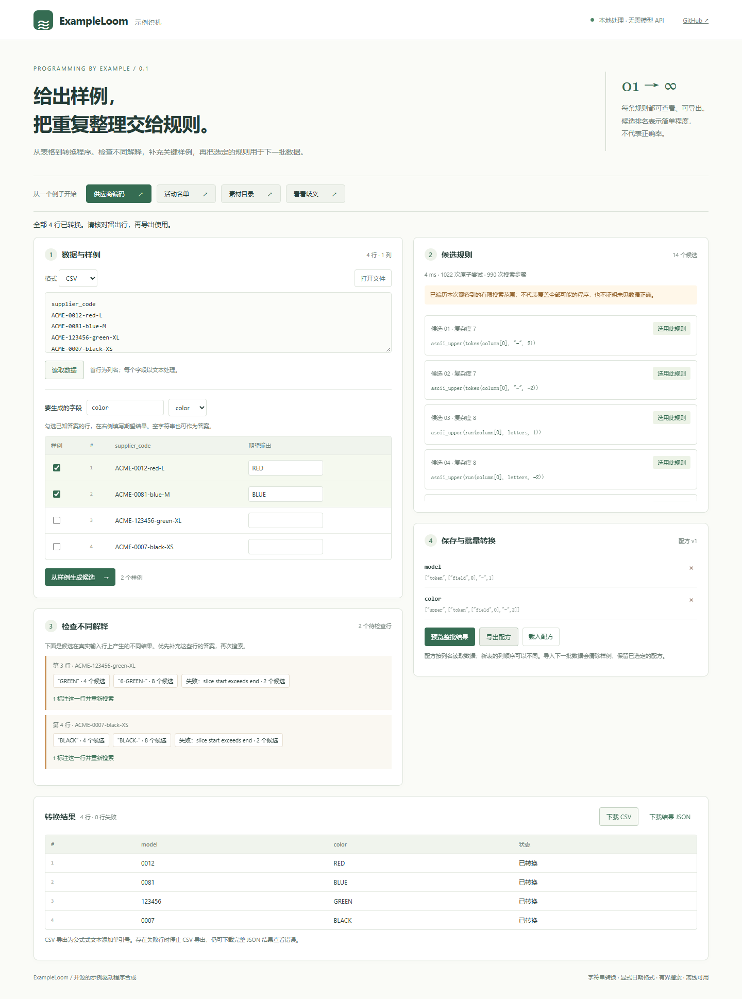

# ExampleLoom

**给出几个样例，生成可检查、可重用的数据转换程序。**

v0.7 增加从样例学习的多字段稳定排序，支持 Unicode 文本序和精确十进制数值序，可与宽表展开等操作组合。执行支持八个排序键，学习至多三个键；相同键保留原始顺序，数值排序保留前导零和小数原文。在表格工作台选择「多字段金额排序」「商品目录排序」「读数展开与排序」可运行完整流程。[覆盖差异与借鉴范围](docs/GAP_ANALYSIS.md) · [排序协议和边界](docs/PROTOCOL.md#stable-row-ordering-v070)

[在线工作台](https://zhangbowen2006.github.io/ExampleLoom/) · [Mooncakes](https://mooncakes.io/docs/zhangbowen2006/exampleloom) · [CI 与运行证据](https://github.com/zhangbowen2006/ExampleLoom/actions) · [版本下载](https://github.com/zhangbowen2006/ExampleLoom/releases)

ExampleLoom 是使用 MoonBit 实现的程序合成引擎、独立浏览器工作台和 CLI。使用者可以整理编号、名单和按地区汇总的记录。导入 CSV/JSONL，标注输入输出样例，比较候选程序的不同解释，明确选择后保存配方并用于下一批数据。浏览器 Worker 在本机执行合成和转换。



## 从样例学到可复用的表格程序

v0.5 可以从混用两种格式的编号学出条件分支，从样例推导捕获组的重排和重复，并把它们用于结构管道。表格工作台和 CLI 都接受 1–8 对训练表。打开「混合编号展开」，选第一条候选，再在下一批数据上预览，可见 `ZZ9530` 生成 `IN/9530`，两个标签展开为两行。打开「地区订单汇总」可试同一管道里的分组计数与有符号整数求和。[表格工作台](https://zhangbowen2006.github.io/ExampleLoom/structure.html)

在公开 IANA 时区数据上，前两批共 30 行用于演示，另外 282 行作为新输入。学得的管道先拆分地区代码，再按地区计数。导出的 236 行与 SQLite 对照逐格、逐行序一致。[可复现验证](scripts/verify-grouping.py) · [外部任务的成功率与耗时](docs/BENCHMARKS.md) · [与 PROSE、Foofah 的功能对比](docs/CAPABILITIES.md)

v0.6 新增从样例学习的指定分隔词替换、可选后缀，以及拆分转长表、记录打包后选列和键值记录还原网格。完整字段的快速搜索与全语法搜索共享原有步数预算。工作台的「字段缩写与后缀」「键值记录还原网格」提供完整训练和新批次流程。当前成绩、未通过任务及评测口径见[基准报告](docs/BENCHMARKS.md)。

v0.6.1 在现有表格工作台补齐交互消歧。选择「候选歧义与补样」，先搜索，再比较下一批结果：同一个训练样例可产生不同表格或执行错误。点击补充训练只复制输入，期望输出由使用者填写；重新学习后，可在第三批数据上重放。该过程不自动选择答案，也不改变原有搜索排名。[初审核验事实](docs/INITIAL_REVIEW.md) · [来源与借鉴范围](docs/RESEARCH.md#v061-维护调研2026-11-11)

## 快速体验

要求 MoonBit（验证版本 `moonc 0.10.17+093cb8f9c`、`moon 0.1.20261021`），工作台/CLI 另需 Node.js ≥20。没有 npm 运行时依赖。

```sh
moon check --deny-warn
moon test --deny-warn
moon run cmd/demo
node scripts/build.mjs
node scripts/serve.mjs
```

新增排序验证：`python scripts/generate-sort-oracle.py` 后执行 `node scripts/sorting-test.mjs`，对照 Python Decimal 与稳定排序的 128 组构造任务，并逐格核对三个学习与新批次流程。

打开 <http://127.0.0.1:4173>，点击“供应商编码”“活动名单”或“素材目录”。两个样例已填好；点击生成候选，检查分歧，选用规则，再预览整批结果。切换示例输出字段可继续添加另一条规则。

点击“看看歧义”可重现：`订单-0012 → 0012`、`订单-0081 → 0081` 同时支持“末尾四位”和“最后一个连字符后的完整编号”。`订单-123456` 能区分它们。补充该行正确输出再搜索。此交互是已有 PBE 技术的应用，不是算法首创声明。

## 已实现功能

- MoonBit 原生有限表达式解释器、输出引导的程序搜索、稳定候选排名。
- 多输入列、多个独立输出字段；字段、常量、分隔词、ASCII 连续段、Unicode 字符区间、trim、ASCII 大小写、拼接、五种显式公历日期格式。
- 实际输入行上的候选分歧（包含失败预测），提示补充有区分力的样例。
- 版本化 JSON 配方；按列名绑定新数据，列顺序变化不影响已保存规则。
- 严格 CSV/JSONL 导入；保留前导零；批处理按行报告错误；失败时停止 CSV 导出。
- 独立中文工作台：文件导入、样例编辑、多字段配方、预览、下载、Worker 取消、手机布局。运行期间无外部数据请求。
- CLI 和公开 Mooncakes 库接口。实际验证与限制见 [VALIDATION.md](docs/VALIDATION.md)。
- v0.2：样例排序/去重，标点分隔符推断及可配置文字分隔符；Token 后截取、组合 trim/case；共享输出位置的搜索转移缓存。编辑样例会使旧规则失效并阻止旧结果导出。
- v0.3：条件分支学习、MoonBit 正则捕获/替换与布尔谓词；17 类表格操作及结构程序搜索；新增[表格结构工作台](https://zhangbowen2006.github.io/ExampleLoom/structure.html)、CLI 管道和完整 Foofah 外部任务评估。支持范围与成熟系统差距见 [功能对比](docs/CAPABILITIES.md)。

## v0.4：扩大搜索与验证

- 条件/正则基础保持兼容；新增从共同字面上下文推断 ASCII 捕获模式、固定分隔符归一化，不要求所有提取任务都手填正则。
- 结构搜索改为带预算的最佳优先搜索和成本排名；补充多步组合见证、行学习缓存、32 条样本之外的全量训练验证。排名不是准确率。
- 新增动态网格透视、命名列合并、变长记录分段、表头上下文传播，共 21 类算子；多对训练表可有不同输出维度，以更多样例区分转置和定长记录打包。
- 在结构工作台新增“动态测量透视”“表头上下文展开”“标签单元格还原”三个完整新批次流程。
- 完整保留 250 个外部任务，发现并单列 25 个缺测试答案的任务；同一口径对照不可变 v0.3.0 引擎。结果与速度取舍见 [基准报告](docs/BENCHMARKS.md)。另以 pandas 参考实现验证 36 个构造任务；这不是外部盲测。

## 条件、正则与表格结构

逐行工作台展开“条件与正则搜索”，可运行条件供应商编码、带上下文的 ref 捕获示例。条件学习至少需要分支两侧各两个样例；正则提示采用 MoonBit core 的 lexmatch 语法，如 `ref=([[:digit:]]+)`。不是自动发明任意正则表达式。

结构工作台输入训练表和期望输出表，搜索后明确选择一条管道，再对下一批表预览、下载。它真实改变表的行列结构，支持宽长表、连续行打包、分组、重排、拆列、展开、筛选等。重复透视单元格、不完整打包和不规则拆列报错，不静默丢弃记录。

```sh
node scripts/build.mjs
node scripts/advanced-test.mjs
python scripts/import-foofah.py
node scripts/benchmark.mjs
node scripts/serve.mjs
```

本地打开 <http://127.0.0.1:4173/structure.html>。结构场景的数据、下一批输入与预期输出位于 `examples/structures/`。动态透视允许下一批新增类别；带标签单元格会自动组合 Fold、拆列与透视。条件与正则场景分别在 `examples/conditional/`、`examples/regex/`。以上演示是构造数据；外部评估使用上游原有任务，完整成功、失败和限额记录见 [BENCHMARKS.md](docs/BENCHMARKS.md)。

结构 CLI 在 `learn-table --data input.csv --target target.csv --out report.json` 后，使用 `pipeline --report report.json --choose 0 --out pipeline.json` 明确选择，再执行 `transform --data next.csv --pipeline pipeline.json --out result.csv`；命令均以 `node bin/exampleloom.mjs` 开头。逐行 `learn` 可选 `--patterns patterns.json` 和 `--depth 0..3`。

## 三个完整使用场景

| 使用者与问题 | 输入与操作 | 输出与验证 |
| --- | --- | --- |
| 小商家/运营整理供应商复合编码 | `examples/products/input.csv`；提供两个型号/颜色样例，分别选择规则 | 型号 `0012`、`123456` 等保留前导零，颜色转大写；另外两行不参与训练，逐值检查 |
| 活动组织者生成名单标签 | `examples/labels/input.csv`；用姓名、班级示范 `A1 / 陈雨`，另外复制编号字段 | 新行生成 `C20 / 赵晨`，编号不变；测试重排列后重用配方仍一致 |
| 内容创作者整理音视频文件 | `examples/media/input.csv`；标注两个日期和 take 编号 | 未见的 `20240229` 正确变为 `2024-02-29`；`invalid.csv` 中 `20260229` 报错并停止 CSV 导出 |

这些是构造的演示数据，并非已获客户采用的证明。可复现实验：

```sh
node scripts/integration.mjs
```

它验证三个场景与额外歧义演示、留出行、配方往返、列名重绑定、CLI 全流程、150 组 CSV 往返，以及 10000 行批处理，并写入 `artifacts/integration-results.json`。

## 公开数据到可用目录

工作台另提供三个公开数据入口，全部记录均纳入验证，不只展示几条成功数据：

| 数据与使用者 | 操作与结果 | 验证范围 |
| --- | --- | --- |
| IANA tzdb 2025b：应用设置页开发者 | 312 个时区标识，示范区域、末级地点，生成可按区域查询的目录 | 3 个字段，每字段 3 条训练，其余 309 条逐值验证 |
| Unicode CLDR 48：国际化开发者 | 766 个 locale，生成语言分组、资源路径和原始标识 | 3 个字段，每字段 3 条训练，其余 763 条逐值验证 |
| github/gitignore：IDE 模板目录开发者 | 312 个多层路径，生成文件名、去扩展名的模板名称和原路径 | 模板名称先有 3 条训练，按分歧提示补 `C` 和 `C++` 两条；其余 307 条验证 |

```sh
python scripts/import-public-data.py
node scripts/public-data-test.mjs
python scripts/verify-sqlite.py
```

前一命令离线校验来源 SHA-256 并生成 CSV/任务；第二条实际学习、保存/重载配方和导出；第三条用 Python CSV 解析器与 SQLite 独立接收导出并查询。产物在 `artifacts/public-data/`，含可打开的 `catalogs.sqlite3`。来源与许可证见 [公开数据说明](fixtures/public/README.md)。

这是公开记录上的项目自定任务，参与过开发，**不是盲测、客户试用或生产准确率证明**。初始 3 条纯字母模板样例曾导致 25 条错误；两次交互修正后留出字段值 4,141 / 4,141 通过。不要忽略分歧检查或把第一候选当作已知正确规则。

## CLI

```sh
node bin/exampleloom.mjs learn --data examples/products/input.csv --examples examples/products/model-labels.json --out candidates.json
node bin/exampleloom.mjs recipe --report candidates.json --choose 0 --name model --out product.recipe.json
node bin/exampleloom.mjs apply --data examples/products/input.csv --recipe product.recipe.json --out product.result.csv
```

候选编号从 0 开始，选择需要显式 `--choose`。检查报告中的其他候选与分歧后再选择；排名不表示正确率。标签文件为 `[{"row":0,"output":"0012"}, ...]`，行号不计表头。JSONL 可加 `--format jsonl`。`run request.json` 支持完整 [JSON 协议](docs/PROTOCOL.md)。

可选 `--separators separators.json`（内容例如 `["来自"]`）补充文字分隔符；最多 16 个，每个 1–16 字符。标点分隔符从全部样例自动观察。

## MoonBit 库

安装发布模块后在 `moon.pkg` 中导入 `"zhangbowen2006/exampleloom" @loom`。完整可运行调用见 `cmd/demo/main.mbt`。

```moonbit
let report = @loom.synthesize([
  { input: ["订单-0012"], output: "0012" },
  { input: ["订单-123456"], output: "123456" },
])
// 先检查 report.truncated、候选表达式和 disagreements，再选择。
let output = @loom.evaluate(report.candidates[0].expression, ["订单-00987"])
```

API 通过 `LoomError` 报告普通输入错误；调用者需要处理异常和空候选数组。`attempt` 返回值形式的错误。`pkg.generated.mbti` 是生成的公开接口。

## 边界与可靠性

**ExampleLoom 的学习范围由内置语法和搜索预算共同决定。** 数值分组支持计数和有符号 64 位整数的求和与极值。多表连接、任意数值计算、循环和自由脚本仍超出实现范围。正则使用 MoonBit core 方言，数字可用 `[0-9]` 或 `[[:digit:]]`。支持整串匹配、捕获组重排和全局替换。前后查找和模式内反向引用超出该方言能力。未见数据应另行验证，`truncated=true` 表示搜索被剪枝。

默认最多 32 个样例、16 输入列、每个样例字段 128 字符、64 候选、6 个拼接片段。整表最多 20000 行、64 列；歧义检查最多前 5000 行。ASCII 词类与大小写有明确限制；日期必须指定格式，不能猜月日。全部预算、状态含义及算法见 [ARCHITECTURE.md](docs/ARCHITECTURE.md)。

结构学习默认最多 4 步、128 状态、2000 次结构尝试；训练最多 8 对表、每对 128 输入行/512 输出行、16 输入列/32 输出列。执行管道最多 16 步、20 万单元格；未声明的透视类别会报错。更复杂表格仍可能超出语法、搜索或部署边界，不能把“通用数据转换引擎”理解为全面覆盖 PROSE/Foofah。

## 工程验证

```sh
moon fmt --check
moon check --deny-warn --target all
moon test --deny-warn --target wasm-gc
moon test --deny-warn --target js
moon test --deny-warn --target wasm
moon info
```

原生后端另需 C 编译器；Windows 需要 MSVC C++ 工具与 SDK。CI 在 Linux 同时测试 native。可选浏览器回归：安装 Playwright 1.62.1 和 Chromium，启动本地服务后运行 `node scripts/browser-test.mjs`、`node scripts/advanced-browser-test.mjs`、`node scripts/browser-recovery-test.mjs`；它们生成桌面/手机截图和 JSON 证据。也支持通过 `PLAYWRIGHT_MODULE` / `BROWSER_EXECUTABLE` 指定已安装环境。

## 来源与维护

MIT 开源。仅依赖工具链 `moonbitlang/core`（Apache-2.0）；浏览器回归使用 Playwright（Apache-2.0，开发期依赖）；可选差分验证使用 pandas 3.1.0（BSD-3-Clause，仅验证环境）。交付的静态 JS 包含编译的 core 代码，分发其许可证与版权声明。

v0.3 另外再分发 Foofah 主仓库 MIT 许可下的全部 250 个 `tests/data/exp0_*.txt` 任务，仅作离线基准，不进入浏览器运行包；固定提交、文件哈希和完整许可见 [fixtures/foofah](fixtures/foofah/README.md)。这不是 Foofah 源码移植，不继承其功能覆盖或性能结论。

该项目由维护者在 AI 辅助下从新目录实现，没有复制旧项目业务代码。算法思想参考既有 PBE 研究；明确对比 Flash Fill、PROSE、Foofah、MoonFrame 和 moon-databridge，见 [调研与来源](docs/RESEARCH.md)。不声称全球唯一，也不保证通过竞赛审核或获奖。

后续优先扩大独立验证数据与真实使用反馈、减少搜索截断、提升候选多样性。欢迎附上最小输入/输出样例、期望结果、工具链版本和复现步骤提交 issue；请移除私人数据。
